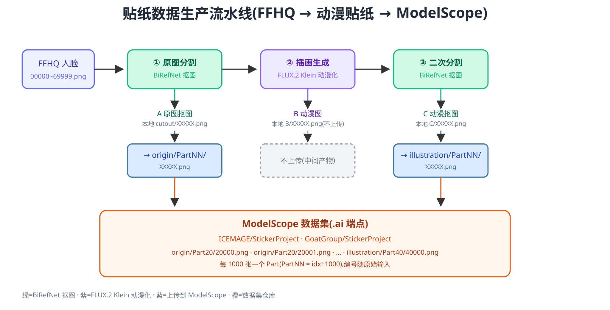

# 贴纸数据生产流水线 — 工作总结

> 把 FFHQ 真人照片批量转成日系动漫贴纸,并按规范上传到 ModelScope 数据集。
> 区间 20000-40000(20001 张)已跑通并上传到 ICEMAGE 与 GoatGroup 两个仓库。



---

## 1. 项目目标

用 ComfyUI + FLUX.2 [klein] 4B 把 FFHQ 人脸照片做成动漫贴纸,产出两张图:

| 图 | 来源 | 上传到 |
|---|---|---|
| **A** | 第一次 BiRefNet 抠图(原图去背景) | `origin/PartNN/XXXXX.png` |
| **C** | 第二次 BiRefNet 抠图(动漫图去背景) | `illustration/PartNN/XXXXX.png` |
| B | 中间 FLUX 动漫图 | **不上传**(只留本地) |

- **Part 分组**:每 1000 张一个 Part,`PartNN = idx // 1000`(两位补零)。如 4321 → Part04。
- **编号**:文件名跟原始 FFHQ 一致(5 位补零,如 `04321.png`)。

---

## 2. 原始工作流与问题

原始工作流 `flux2-V3-保存分割-仅插画.json`:单条链 FFHQ → BiRefNet 抠图 → 贴黑底 → FLUX 图生图 → 提饱和度 → 二次 BiRefNet 抠图。

两个设计问题:
1. **中断不能续跑**:`LoadImageDataSetFromFolder`(核心节点)每次都把整个文件夹从头读一遍,且不排序,断点续跑不可靠。
2. **只能整链跑**:没有分段入口,不能只跑其中一段。

---

## 3. 自定义节点开发

文件:`ComfyUI/custom_nodes/resume_image_loader.py`,含 3 个节点。

### LoadUnprocessedImagesFromFolder
- 从文件名解析原始编号(`00001.png` → `1`),输出 `images / masks / indices` 三个列表。
- **按编号逐文件断点续跑**:检查 `output/{done_prefix}/{idx:05d}.png` 是否存在,跳过已完成的——任意区间/子集/顺序都能续。
- 区间选择:`start_index` / `count`(0=到末尾)。
- 分批:`batch_size`(控内存,7 万张 FFHQ 不会爆)。
- `IS_CHANGED` 返回 NaN:强制每次排队都重读磁盘,绕开 ComfyUI 按 widget 值的缓存(否则覆盖同名文件不会重读)。

### SaveImageIndexed
- 按编号存 `output/{prefix}/{idx:05d}.png`,让编号贯穿各段(文件夹中转时身份不丢)。
- `OUTPUT_NODE = True`。

### UploadToModelScope
- 异步上传(线程池)到 `{folder}/Part{idx//1000:02d}/{idx:05d}.png`。
- **endpoint 直设 `api._config`**:`modelscope_hub` 的 config 单例在 import 时读了默认 `.cn`,在节点里设 `os.environ` 太晚,所以直接 `api._config.endpoint = ...; api._config.token = ...`。
- 幂等:列仓库一次(缓存),已存在的跳过。

---

## 4. 工作流重构

`flux2-V3-分段可续跑-仅插画.json`:把单链拆成 3 条独立、靠文件夹中转的链:

- **① 原图分割**:FFHQ → BiRefNet A → `cutout/{idx}.png` + 上传 `origin/PartNN/`
- **② 插画生成**:`cutout/` → 贴黑底 → FLUX → `B/{idx}.png`(不上传)
- **③ 二次分割**:`B/` → BiRefNet C → `C/{idx}.png` + 上传 `illustration/PartNN/`

三段可独立运行(静默其他两段),也可按 ①→②→③ 跑整条。

另有**子图展开器**(用于 API 跑原工作流):把 UI 格式(含 FLUX/BiRefNet 子图)展开成 ComfyUI `/prompt` 的 API 格式。

---

## 5. ModelScope 上传机制

### 端点
- ModelScope 有 `.cn` 和 `.ai` 两个端点,**token 和数据集都在 `.ai`**。SDK 默认连 `.cn` 会报"token 错误"或"数据集不存在"。
- 解决:设 `MODELSCOPE_ENDPOINT=https://www.modelscope.ai`,或节点里 `api._config.endpoint`。

### 鉴权与权限
- `ms-` token → `login` 换 `glpat-`(GitLab PAT,ModelScope.ai 是 GitLab 后端)。
- **token 必须是数据集 owner**:Chalkki/StickerProject 写被拒(token 账号非 owner,gated 只读);ICEMAGE/StickerProject、GoatGroup/StickerProject 写通(token 账号有写权限)。

### 1000 commits/天限制(关键坑)
- ModelScope 每仓库每天 **1000 次 commit**。每次 `upload_file` = 1 commit,所以逐文件上传传到 ~995 就被限流(429),20000 张要 40 天。
- **解决:用 `upload_folder` 批量提交**——多个文件合并成一次 commit(每批 256 文件)。一个 Part(1000 张)≈ 4 次提交,20000 张 ≈ 80 次提交,远低于限额。
- **LFS 全局去重**:跨仓库复用 blob。从 ICEMAGE 复制到 GoatGroup 时,blob 已存在 → 只做提交、不重传,21 个 Part ~10 分钟传完。

---

## 6. 生产脚本

| 脚本 | 作用 |
|---|---|
| `_runrange_local.py <start> <end>` | 纯本地生成(无上传),断点续跑(按 cutout 是否存在跳过) |
| `_partwatcher.py <start> <end>` | 和生成并行,每分钟扫本地,Part 攒满 1000 就 `upload_folder` 传一次 |
| `_batchupload.py` | 全量批量上传本地 cutout/C 到 ICEMAGE(一次性) |
| `_copy_to_goat.py` | 把 Part20-40 复制到 GoatGroup(逐 Part) |
| `_runrange_inflated.py <start> <end>` | **膨胀风格**生成:复用 cutout/,FLUX 膨胀提示词,存 B_inflated/C_inflated |
| `_partwatcher_inflated.py <start> <end>` | 监听 C_inflated,Part 攒满传 `inflated/` |
| `_copy_inflated_to_goat.py` | 把 inflated Part20-40 复制到 GoatGroup |

都在 `C:\Users\Persona\` 下,用 ComfyUI 自带 python 跑:`python\python.exe <脚本>`。

---

## 7. 实际运行结果(20000-40000)

- **生成**:20001 张,~4-5 秒/张,中途暂停/恢复过(断点续跑正常)。
- **上传 ICEMAGE/StickerProject**:Part20-30(批量 `_batchupload.py`)+ Part31-40(watcher 逐 Part)。
- **复制 GoatGroup/StickerProject**:21 个 Part × ~4 commits ≈ 84 commits,~10 分钟(LFS 去重)。
- 两个仓库现在都有 `origin/Part20-40/` + `illustration/Part20-40/`,编号 20000-40000。

---

## 7.5 多风格扩展:膨胀(inflated)

同一批 A(抠图)可复用,只换 FLUX 提示词产出新风格的 C,传到新文件夹。以"膨胀"(充气乙烯气球)为例:

- **复用 A**:加载器读本地 `cutout/`(20000-40000),不重跑 stage A、不重传 `origin/`。
- **FLUX 膨胀提示词**:取自 `flux2-V3-保存分割-仅膨胀.json`(inflatable vinyl balloon 长提示词)。
- **保留 561 亮度**:brightness 1.1 / contrast 1.05 / saturation 1.25。
- **产出**:B_inflated(中间,不上传)、C_inflated → `inflated/PartNN/XXXXX.png`。
- **修了一个加载器 bug**:`start_index` 原按位置切(FFHQ 里位置=编号所以没事,但 cutout/ 从 20000 开始,位置≠编号),改成按 idx(文件名编号)过滤。

**结果(20000-40000,20001 张)**:生成 ~6s/张;ICEMAGE `inflated/Part20-40/` 全部传完(watcher 逐 Part);复制 GoatGroup(LFS 去重,~10 分钟)。

现在 ICEMAGE/StickerProject 上同一批 20000-40000 有三种数据:

| 文件夹 | 内容 |
|---|---|
| `origin/Part20-40` | A 原图抠图 |
| `illustration/Part20-40` | C 动漫抠图 |
| `inflated/Part20-40` | C 膨胀气球抠图 |

加新风格同理:换 FLUX 提示词 + 新文件夹名 + 复用 cutout/。

---

## 8. 文件清单

| 文件 | 位置 |
|---|---|
| 自定义节点(3 个) | `ComfyUI/custom_nodes/resume_image_loader.py` |
| 重构工作流(插画) | `ComfyUI/user/default/workflows/flux2-V3-分段可续跑-仅插画.json` |
| 原始工作流(插画) | `ComfyUI/user/default/workflows/flux2-V3-保存分割-仅插画.json` |
| 膨胀工作流 | `ComfyUI/user/default/workflows/flux2-V3-保存分割-仅膨胀.json` |
| 生产脚本(插画) | `C:\Users\Persona\_runrange_local.py`、`_partwatcher.py`、`_batchupload.py`、`_copy_to_goat.py` |
| 生产脚本(膨胀) | `C:\Users\Persona\_runrange_inflated.py`、`_partwatcher_inflated.py`、`_copy_inflated_to_goat.py` |
| GitHub 仓库 | https://github.com/ICEMAGE233/ComfyuiWorkflow(工作流 + 节点 + README) |

---

## 9. 关键经验与坑

1. **ComfyUI 缓存**:`LoadImage` 按文件名缓存,覆盖同名文件不会重读 → 用 `IS_CHANGED(NaN)` 强制重跑。`LoadImageDataSetFromFolder` 还不排序,断点续跑不可靠。
2. **空列表报错**:加载器返回空列表时 `SaveImage` 会 `IndexError` → 返回 `ExecutionBlocker(None)` 静默阻断下游。
3. **ModelScope `.ai` vs `.cn`**:token/数据集在 `.ai`,SDK 默认 `.cn` 失败。
4. **1000 commits/天**:逐文件上传撞限,改 `upload_folder` 批量提交。
5. **权限**:token 账号必须是数据集 owner(或 maintainer),否则只读。
6. **LFS 全局去重**:跨仓库复用 blob,复制很快。

---

## 10. 后续使用指南

跑新区间(如 40000-60000):
```
python\python.exe C:\Users\Persona\_runrange_local.py 40000 60000
python\python.exe C:\Users\Persona\_partwatcher.py 40000 60000
```
- 生成从断点接着(已存的 cutout 跳过)。
- watcher 逐 Part 传到 ICEMAGE。
- 想同时传 GoatGroup:改 `_copy_to_goat.py` 的 START/END 后跑。

换仓库:改脚本里的 `REPO = "..."`。

换 token:改脚本顶部的 `TOKEN`,或节点 `UploadToModelScope` 的 `token` widget。

**注意**:ComfyUI 得一直开着(脚本通过 API 调它);`resume_image_loader.py` 改动后要重启 ComfyUI 一次。
